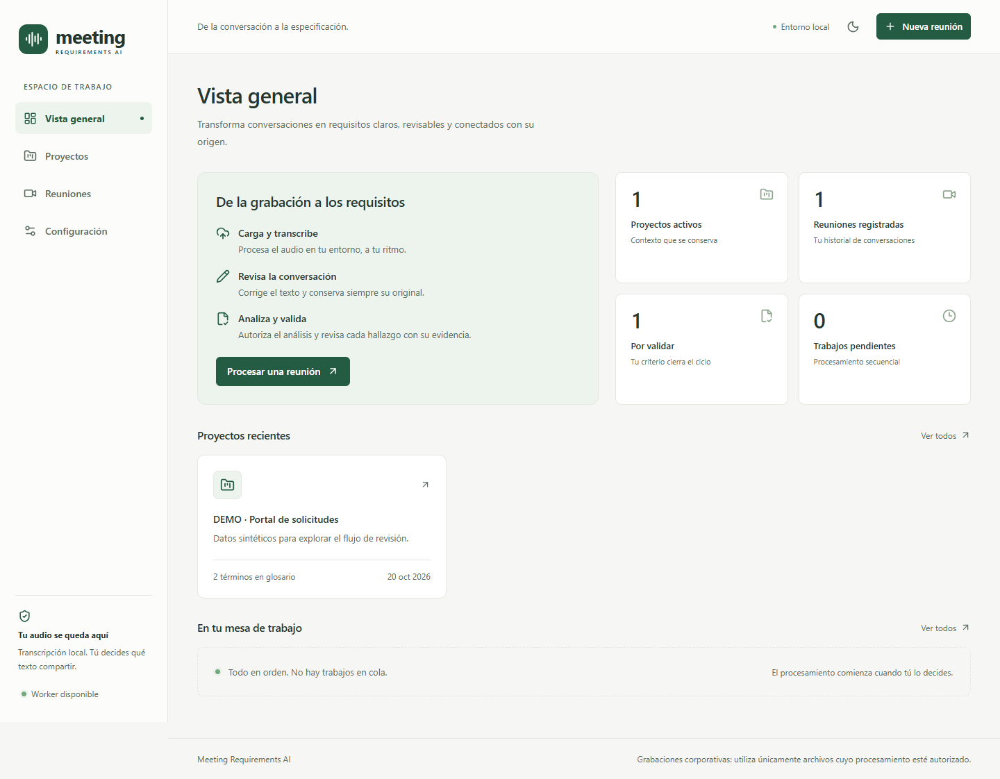

<p></p>

# Meeting Requirements AI

**Turn meeting recordings into reviewable requirements, backed by the conversation.**

A self-hosted workspace for recording review, local transcription, AI-assisted analysis, and explicit human approval. Run the complete application with Docker Compose. Keep the original text, follow every requirement back to its evidence, and export a versioned specification when you are ready.

[Quick start](#quick-start) · [Features](#features) · [Privacy](#privacy-and-chatgpt) · [Documentation](#documentation) · [Development](#development-and-tests)



> **Alpha software.** The interface and detailed guides are currently in Spanish. This edition is designed for a single owner on a local machine. It is not a public, multi-user service.

## Quick start

You need **Docker Engine or Docker Desktop with Docker Compose v2.24.4 or later**. Python, Node.js, FFmpeg, and transcription dependencies run inside the containers. A GPU is not required.

Download the source, open its directory, and run:

```sh
docker compose up --build -d
docker compose ps
```

Open **[http://127.0.0.1:8080](http://127.0.0.1:8080)**. Use this exact host for ChatGPT authentication as well.

The first build downloads images and dependencies. Transcription models download only when requested. The default configuration works without an `.env` file; copy [`.env.example`](.env.example) to `.env` to change the port or resource limits.

```sh
# Follow service logs
docker compose logs -f

# Stop the application and keep its data
docker compose down
```

The default Compose project is `meeting-requirements-ai-local`. For another installation, use a distinct project name with `docker compose -p <name>` in every command and set an unused `APP_PORT`, such as `8081`, in `.env`. A project name identifies its persistent volumes, including its authentication storage.

### Try the review workflow

Create synthetic example data explicitly:

```sh
docker compose exec backend python -m app.seed
```

Each run creates a new DEMO project with a simulated transcript and clearly labeled Mock results. It does not contact ChatGPT or change your configured provider. For a new analysis without authentication, select **Mock** in **Configuración**. Simulated transcription is available only in test environments; normal recording transcription uses faster-whisper.

## Features

| Workflow | What you can do |
| --- | --- |
| Project context | Organize meetings by project and maintain a business context and glossary. |
| Recording import | Upload MP4, M4A, MP3, or WAV files with actual media validation and a configurable initial 4 GiB limit. |
| Local transcription | Run faster-whisper on CPU with INT8, reusable model downloads, checkpoints, and manual retries. |
| Transcript review | Review timestamped segments alongside the player, correct text, flag uncertainty, and retain the original. |
| Evidence-based analysis | Authorize an exact input snapshot and extract requirements, acceptance criteria, and related artifacts through ChatGPT or explicit Mock. |
| Human decisions | Edit, validate, or reject requirements and criteria. Preserve generated originals and the history of revisions and decisions. |
| Versioned output | Keep independent analysis runs and immutable Markdown/ZIP exports, including evidence and traceability. |

### A deliberate review process

1. **Create a project.** Add the context and terms needed to understand the meeting.
2. **Upload and transcribe.** Processing starts only when you request it; one heavy job runs at a time.
3. **Review the transcript.** Correct the text before authorizing an analysis.
4. **Choose the provider.** Connect your own ChatGPT account or explicitly select Mock.
5. **Review the exact input and consent.** Only the authorized text, context, and glossary are submitted for analysis; audio stays in the local transcription workflow.
6. **Review the findings.** Check the citations and edit, validate, or reject each item.
7. **Export the specification.** Generate a new export without overwriting earlier packages.

Acceptance criteria have their own approval state, independent of functional and non-functional requirements. Editing a criterion's Given/When/Then text returns it to pending validation. Its original and history remain available. Validation approves the specification; it does not certify that an implementation has passed tests. Historical analysis runs must be activated before editing, and revision conflicts preserve your unsaved draft.

## Privacy and ChatGPT

Transcription runs locally. Real analysis is an explicit external operation: the authorized text is sent through your own ChatGPT connection. This is not an entirely offline application when using ChatGPT.

- **Application-owned OAuth.** Connect from the settings screen. The application does not import the host's Codex credentials or mount your user credential directory.
- **Private token storage.** Authentication is stored in its own persistent volume, outside the frontend and exported specifications.
- **Consent for each analysis.** Review the fixed input snapshot before authorizing it. Uploading a recording does not authorize an inference.
- **Explicit consumption policy.** Set this application's credit limit to **zero** in ChatGPT's usage controls, then confirm that setting locally. This is a manual declaration, not a remote verification of the limit. Eligibility and plan availability still apply; a connection or model list alone does not prove inference access.
- **No automatic billing fallback.** There is no API-key fallback, automatic top-up, or switch of billing provider. Quota-blocked work is retained for manual resumption.
- **No Meeting Requirements account or subscription.** The local edition does not require a hosted Meeting Requirements service. Each installation connects its own ChatGPT account.

Use recordings you are authorized to process. The application does not bypass meeting-platform restrictions or organizational policies. See [authentication](docs/CHATGPT.md), [provider boundaries](docs/PROVIDERS.md), and [security](docs/SECURITY.md) for details.

## Architecture and storage

```text
Browser → Frontend / proxy → FastAPI
                               ↕
                    SQLite + persistent files
                               ↕
                       Single CPU worker
```

Frontend, backend, and worker have separate Dockerfiles. Initialization prepares permissions and migrations before the application starts. Only the frontend port is published, on `127.0.0.1`; backend and worker communicate inside Compose.

SQLite is the default. [PostgreSQL is optional](docs/POSTGRESQL.md). Named volumes hold the database, recordings, transcripts/checkpoints, exports, models, and authentication. SQLite storage must remain on a supported local filesystem, not NFS, SMB, or a synchronized folder.

The worker initially has **3 CPUs and 3 GiB RAM**; all service limits are configurable. Leave additional memory for the remaining services and image builds. Higher-quality transcription may require more worker memory. No CUDA or dedicated GPU is required.

`docker compose down` preserves data. **`docker compose down -v` deletes volumes.** Follow the [backup and restore guide](docs/OPERATIONS.md) before moving or changing an installation. Backups exclude OAuth credentials; connect ChatGPT again on a new installation. Backups contain meeting data and should be protected even though Git and Docker ignore their archive files.

## Platform status and limitations

- **Linux amd64 / Windows with WSL2:** the application has been built and tested through Docker in the documented environment.
- **ARM64:** earlier dependency/inference checks used emulation. This does not establish native macOS compatibility or performance for the current release.
- **macOS Intel and Apple Silicon:** native application verification remains pending. Do not treat multiarch base images as proof of end-to-end support.

This Alpha does not provide speaker diarization, semantic consolidation across meetings, concurrent heavy processing, or a production multi-user deployment. AI output requires review; it is not an automatic approval or a guarantee of correctness.

## Development and tests

Use Compose for development, too:

```sh
docker compose -f compose.yaml -f compose.dev.yaml up --build
```

React uses hot reload and FastAPI reloads on changes. Worker changes require `docker compose restart worker`; checkpoints are retained. Rebuild images when dependencies change. Use the same Compose files when stopping development services.

Run the automated suite with isolated projects and Mock providers:

```sh
sh scripts/test.sh
sh scripts/test-postgres.sh
sh scripts/test-operations.sh
sh scripts/test-worker-recovery.sh
```

The main suite covers backend tests, frontend tests, linting, and a cross-container HTTP workflow with synthetic audio, real ffprobe, simulated transcription, and Mock analysis. Operational checks cover backups, restoration, exclusive worker execution, interruption, and manual recovery. They retain their own test volumes and do not use your normal installation's data. No account, model download, or paid inference is needed.

For backend tests alone:

```sh
docker compose -p meeting-ai-test -f compose.yaml -f compose.test.yaml run --build --rm backend pytest
```

Real transcription checks are separate and opt-in; they may download a model. See the [verification guide](docs/VERIFICATION.md). A real ChatGPT check additionally requires an eligible account, your selected model, your consumption policy, and explicit authorization of the input.

## Documentation

The detailed guides currently use Spanish; commands and file paths are shared with this README.

| Guide | Contents |
| --- | --- |
| [Installation](docs/INSTALLATION.md) | Windows/WSL2, Linux, macOS, and resource configuration |
| [Architecture](docs/ARCHITECTURE.md) | Components, persistent volumes, API, and review behavior |
| [Operations](docs/OPERATIONS.md) | Backup, restoration, migration, and recovery |
| [ChatGPT](docs/CHATGPT.md) | Authentication, consent, eligibility, and usage controls |
| [Security](docs/SECURITY.md) | Privacy boundaries and local deployment precautions |
| [PostgreSQL](docs/POSTGRESQL.md) | Optional database configuration and migration |
| [Providers](docs/PROVIDERS.md) | Supported providers and extension boundaries |
| [Verification](docs/VERIFICATION.md) | Reproducible tests and verification limits |

## Contributing

Keep changes reviewable and include the relevant Compose checks. Preserve original transcripts, generated evidence, explicit approvals, and existing exports. Do not commit meeting files, databases, models, `.env` files, tokens, or backups. Use synthetic examples when reporting problems; do not include account credentials or private meeting content.

## License

[MIT](LICENSE). Review the licenses and terms of the dependencies and external providers you choose to use.
